<div align="center">
  
</div>

<p align="center">
  <a href="#captain"></a>
  &nbsp;
  <a href="#focus"></a>
  &nbsp;
  <a href="#whats-next"></a>
</p>

<p align="center"><strong>Building CAPTAIN — a local AI assistant that turns objectives into actions.</strong><br />
Voice and text · Linux automation · Authorized security labs</p>

---

## About

```python
profile = {
    "identity": "D3FAULTH",
    "flagship": "CAPTAIN",
    "focus":    ["local AI", "voice control", "security labs"],
    "workflow": ["plan", "act", "verify", "report"],
    "building": "a public starter with private extensions",
}
```

I'm building tools that connect AI reasoning with practical work on Linux. My focus is voice-driven automation, repeatable lab experiments, and results that can be inspected and reproduced.

**CAPTAIN by D3FAULTH** is the flagship project. The aim is to give it an objective, let it work within a configured scope, and get back evidence of what happened. When context is missing, it can ask a question.

## CAPTAIN

**Your objective. A plan. Actions. Evidence.**

CAPTAIN is a local voice and tool-using AI assistant for Linux, personal automation, and authorized security labs.

| In the current alpha | Purpose |
| :--- | :--- |
| Voice and text interaction | Give objectives and answer clarifying questions. |
| Configurable model backends | Use Ollama or an explicitly selected API backend. |
| File and command tools | Work in a configured workspace and execution environment. |
| Sessions and reports | Keep local task history and review tool results. |
| Private extensions | Connect separately installed specialist modules. |

**Status:** `0.2.0a1` · Private development alpha · Laptop validation pending.

The code includes these features; end-to-end voice, model, and desktop behavior still needs validation on the target laptop. A public release will follow reproducible demonstrations and release review.

<details>
<summary><strong>The public / private plan</strong></summary>

The planned public starter will run without private modules. It will include setup instructions, a reproducible example, and documented limitations.

Specialized tools and experimental integrations stay in separate private repositories. Planned **CAPTAIN Labs** material will show sanitized demonstrations, methods, and observed results.

Local inference is the intended default. Hosted model backends remain optional and have different data-sharing implications.

</details>

## Focus

| Area | What I'm building toward |
| :--- | :--- |
| **Local AI** | Useful workflows with configurable models and local session memory. |
| **Voice control** | Spoken objectives, clarification, and task summaries. |
| **Linux automation** | Practical file, terminal, and desktop workflows. |
| **Security labs** | Repeatable experiments in authorized environments. |
| **Reproducible work** | Clear setup, observed results, and documented failures. |

## Project stack

These technologies are used in CAPTAIN's current implementation or supported integrations.

| Layer | Technologies |
| :--- | :--- |
| Core | Python · Linux · SQLite |
| Models | Ollama · OpenAI Responses · Compatible Chat Completions servers |
| Speech | Vosk · eSpeak NG |
| Execution | Docker · Configured host commands · Optional X11 tools |
| Development | Git · GitHub Actions · Python unittest |

## What's next

- [ ] Validate the first complete workflow on the target laptop.
- [ ] Record a reproducible demonstration with its results and limitations.
- [ ] Prepare a standalone public starter and a clear quickstart.
- [ ] Publish sanitized lab examples and improve them with tester feedback.

The next milestone is a demonstration someone else can reproduce from a fresh setup.

---

<p align="center">
  <strong>Follow D3FAULTH for CAPTAIN development, demonstrations, and release updates.</strong><br />
  <a href="https://github.com/d3faulth-private">GitHub profile</a>
</p>

<div align="center">
  
</div>
