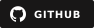

<div align="center">
  
</div>

<p align="center">
  <a href="https://github.com/d3faulth-private"></a>&nbsp;
  <a href="#about"></a>&nbsp;
  <a href="https://github.com/d3faulth-private?tab=repositories"></a>&nbsp;
  <a href="#building-a-team"></a>
</p>


<a id="about"></a>

## 👨‍💻 About

```python
profile = {
    "handle"   : "D3FAULTH",
    "role"     : "Hacker · Security Research",
    "focus"    : "Authorized real-world offensive security",
    "building" : "Private AI · Private security tools",
    "team_os"  : "Anonymous OS · Members-only access planned",
    "training" : "Hack The Box",
    "team"     : "Building a private security team",
}
```

I'm **D3FAULTH** — a hacker building a private team for authorized real-world security assessments, vulnerability research, and defensive engineering. The direction is our own **private AI**, **private security tools**, and **Anonymous OS** for team members.

**Hack The Box** stays part of our training. This GitHub will showcase selected tools, research, and writeups, while internal tooling and team work stay private.


## 🛠️ Toolkit & Focus

**Core**


**Environment**


**Security Lab**


**Research Interests**


## 🛡️ Private Team Platform


- **Private AI:** a team-controlled assistant for research, automation, and evidence analysis.
- **Private tools:** custom tooling for authorized assessments, attack simulation, and security validation.
- **Anonymous OS:** our custom amnesic security workstation, with privacy and security controls built into its design. Distribution is intended for **team members only**.

**In development.** These are the team's planned capabilities; release readiness and security validation remain work in progress.


<a id="building-a-team"></a>

## 🏴 Building a Team

**Team in formation — private research, authorized assessments, and shared infrastructure.**

Looking for hackers and builders interested in offensive security, reverse engineering, operating-system hardening, AI, and tool development. We'll train on Hack The Box, develop our private platform, and apply that work to systems we own or have permission to test.

**[Interested in joining? Introduce yourself →](https://github.com/d3faulth-private/README.md/issues/new?title=Team%20interest)**  
Share your handle, interests, and usual availability. Introductions through GitHub Issues are public.


## 📊 GitHub Stats

<p align="center">
  <a href="https://github.com/d3faulth-private">
    
  </a>&nbsp;
  <a href="https://github.com/d3faulth-private">
    
  </a>
</p>
<p align="center">
  <a href="https://github.com/d3faulth-private?tab=repositories">
    
  </a>
</p>


<div align="center">
  
</div>
